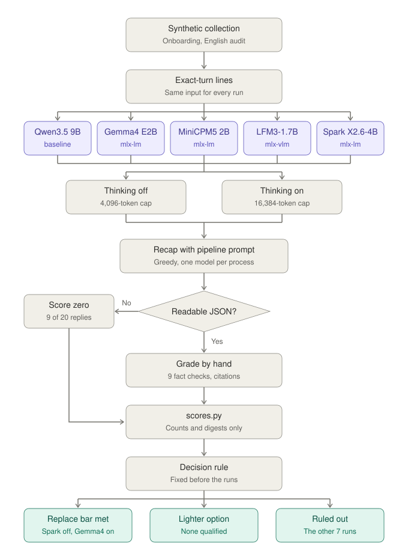

# 2026-11-28: four small language models as the recap model

**Status:** complete

**Outcome:** Two settings matched Qwen3.5 9B on the two synthetic calls, with 6 of 9 facts fully correct with supporting citations and the same number of reopened questions. Spark X2.6-4B with thinking off had a 35% lower memory peak and took about the same time. Gemma4 E2B with thinking on had a 29% lower peak and took about 27 s per call. With thinking off, Gemma4 E2B, MiniCPM5 2B and LFM3-1.7B got 4 of 9 or fewer. With thinking on, every model except Gemma4 thought until the 16,384-token cap on both calls and returned no usable recap, Qwen included. The default doesn't change yet: Spark (thinking off) and Gemma4 E2B (thinking on) go on to the long real calls of #28 as candidate recap models (decision 20).

## Reproduce

| Step | Command |
| --- | --- |
| Set up once (needs the network) | `experiments/small-recap-models/setup.sh` |
| Run everything | `experiments/small-recap-models/run.sh "$FIXTURES" "$OUT"`, then the same with `--thinking`, `--thinking-budget` and `--thinking-sampled` in turn |
| Check saved results without models | `uv run --project experiments/small-recap-models experiments/small-recap-models/scores.py "$OUT"` rebuilds the measurements from saved runs; [the saved measurements](2026-11-28-small-recap-models-results.json) are the committed copy |

- **It needs:** `FIXTURES`, the verified 17-recording collection built by [`collection.py`](../../experiments/synthetic-call/README.md#seventeen-recording-collection), and `OUT`, a new absolute path outside Git. The script refuses a folder inside Git.
- **It writes:** for each call, `OUT/<call>/lines.json` (the transcript lines every model reads) and `OUT/<call>/<run>/{notes.json,summary.md,run.json}`, where `<run>` is the model name, with `-thinking` for the thinking-on arm and `-thinking-budget` or `-thinking-sampled` for the later thinking variants; `OUT/<run>.time` from `/usr/bin/time -l`; and the measurements in `OUT/scores.json`.
- **Takes about:** 3 minutes for the thinking-off arm and 41 minutes for the thinking-on arm, including model loading (2026-11-28, models already downloaded). Most of the thinking-on time is models thinking until the cap. Grading by hand took longer.
- **By hand:** grading each recap against the fixed checks below, saved as `OUT/judgments.json` in the format `scores.py` describes, then rerunning `scores.py`.
- **Expect to differ:** timings and memory on any rerun. Model text should repeat on the same machine and package versions, since decoding is greedy, except in the `-thinking-sampled` runs, which sample with seed 0 and may differ elsewhere.

## Question

Can a model of 1.7 to 4 billion parameters write recaps as good as Qwen3.5 9B's, on the same prompt and transcripts, with less memory or time?

- **Decision it informs:** whether one of Gemma4 E2B, MiniCPM5 2B, LFM3-1.7B or Spark X2.6-4B replaces Qwen3.5 9B as the recap model (decision 7), is offered as a lighter option, or is ruled out. Related to #70, which asks the same question of Apple's on-device model.
- **Expected result:** the small models are faster and use much less memory, but lose facts, mainly owners and corrected values, and cite fewer supporting lines. A small model that matches Qwen on the checks with a third of its memory would change the default.
- **Builds on:** the [17-recording collection recap experiment](2026-11-02-synthetic-collection-recaps.md), whose `exact` arm gave Qwen3.5 9B the script's exact turns and scored 6 of 9 facts fully correct.

## Plan

- **Input:** the script's exact turns of two synthetic calls from the collection at `4c8c2f0`: onboarding (four speakers, Mandarin with English terms, testing ownership) and English audit (one speaker, testing corrected values). These are the inputs of the 2026-11-02 experiment's `exact` arm, built the same way: each turn labeled `Speaker <id>`, adjacent turns of one speaker joined, text converted to Traditional Chinese with OpenCC `s2tw`. Exact turns keep transcription and speaker errors out of the comparison.
- **Assumptions:** one M2 Pro with 16 GB, one model in memory at a time, each model in its own process; all models downloaded before the timed runs. Both calls fit in one prompt, so no merge step runs.

| Run ID | Model and pinned version | Settings |
| --- | --- | --- |
| `qwen3.5-9b` | `mlx-community/Qwen3.5-9B-4bit` at `8b2b98c0`, through mlx-lm 0.32.2 | The pipeline's recap prompt, greedy decoding, thinking off, 4,096-token output cap |
| `gemma4-e2b` | `lmstudio-community/gemma-4-E2B-it-MLX-4bit` at `31512dab`, through mlx-lm 0.32.2 | Same |
| `minicpm5-2b` | `openbmb/MiniCPM5-2B-MLX` at `c8c072db`, through mlx-lm 0.32.2 | Same |
| `lfm3-1.7b` | `LiquidAI/LFM3-1.7B-MLX-4bit` at `91f34088`, through mlx-vlm 0.8.1 | Same |
| `spark-x2.6-4b` | `mlx-community/Spark-X2.6-4B-OptiQ-4bit` at `6d83e911`, through mlx-lm 0.32.2 | Same |

All five run on MLX 0.32.4, the pipeline's version, as decision 7 requires. No mlx-lm release loads LFM3 yet, so it runs through mlx-vlm, the route its official MLX build documents. Spark X2.6's repository offers custom tokenizer code; it is never run (no `trust_remote_code`), and the tokenizer loads without it. Gemma4 E2B has no `mlx-community` build, so the LM Studio community build is used.

`qwen3.5-9b` is the baseline, rerun here on the same lines. Its `summary.md` is expected to match the 2026-11-02 `exact` recap byte for byte, which checks that the lines and prompt are the same.

**Checks.** Each recap is scored full, partial, or absent or wrong on the nine checks of the [2026-11-02 experiment](2026-11-02-synthetic-collection-recaps.md#plan), unchanged:

- **Onboarding:** account test owner and time; documentation owner and time; test access restored; production access still separate and unapproved.
- **English audit:** corrected adapter total; usable cable count; scale fault unresolved; corrected booking; delivery expected, not received.

For each check, the grader also records whether the lines the recap cites for that fact support it. Reopened settled questions and unsupported or garbled details are counted, as before. A recap whose reply isn't readable JSON scores zero on its call. One grader grades all five models' recaps in one pass, knowing which model wrote each, and the Qwen grades are compared with the 2026-11-02 grades of the same text as a consistency check.

**Decision rule, fixed before the runs.** A small model can **replace** Qwen only if, across both calls, it has at least as many facts fully correct with supporting citations as Qwen in this run, reopens no more settled questions, and has no unreadable reply. It can be **offered as a lighter option** if it is at most one such fact behind Qwen, has no unreadable reply, and peaks at under half of Qwen's memory. Otherwise it is ruled out for now. Either way, nine checks on two synthetic calls aren't enough to change the default alone: a model that passes goes on to the long real calls of #28 before decision 7 changes.

### Changes to the plan

**2026-11-28, after the thinking-off results: a thinking-on arm.** Every run above has thinking off, which matches the pipeline but may undersell small models, which often gain the most from thinking. All five models' chat templates take `enable_thinking`, so each model runs a second time with thinking on, under run ID `<model>-thinking`, with a 16,384-token output cap, as in the recap-stage plan's variant A2. Nothing else changes: the same lines, prompt, greedy decoding, nine checks, citation grading and grader. The parser also drops Gemma4's thinking channel, which ends with `<channel|>` instead of `</think>`; re-reading every thinking-off reply with it gave the same notes, and LFM3's onboarding reply still fails. A thinking-on reply that hits the cap before its JSON counts as unreadable.

The thinking-on runs are judged by the same rule, against the thinking-off Qwen3.5 9B baseline above, since that is the current default; each run's own memory peak is used. This change is committed before any thinking-on run. It was decided after the thinking-off results were known, so the choice to test thinking at all was not blind to them.

**2026-11-28, after the thinking-on results: two ways to stop the runaway thinking.** Qwen, Spark, MiniCPM5 and LFM3 thought until the 16,384-token cap on both calls. Two causes are plausible, and each gets one more thinking-on run of those four models, with the same lines, prompt, nine checks, citation grading, grader and decision rule (against the thinking-off Qwen baseline):

- **`<model>-thinking-budget`: a thinking budget, with greedy decoding.** After 2,048 reply tokens without `</think>`, the runner forces a newline, `</think>` and a blank line, one token at a time, then lets the model write its JSON, with a 6,144-token cap (the budget plus the thinking-off cap). This is how oMLX's `thinking_budget` works (its `ThinkingBudgetProcessor`), added to the mlx-lm and mlx-vlm runner as a logits processor instead of running oMLX, which didn't reproduce the stage's output (decision 21). 2,048 is just above the about 1,700 tokens Gemma4 E2B thought per reply when it finished on its own. A model that closes its thinking before the budget is left alone.
- **`<model>-thinking-sampled`: each model card's recommended sampling, with no budget.** Greedy decoding is known to make thinking repeat itself; Qwen's model card says not to use it with thinking. The cap stays 16,384, seed 0, one run per call. The settings are taken from each model's card or `generation_config.json` at its pinned or named revision: Qwen3.5 9B, temperature 1.0, top-p 0.95, top-k 20, min-p 0, presence penalty 1.5 ("thinking mode for general tasks", from `Qwen/Qwen3.5-9B` at `c2022362`); MiniCPM5 2B, temperature 1.0, top-p 0.95, min-p 0; LFM3-1.7B, temperature 0.1, top-k 50, repetition penalty 1.1 (its card's thinking example); Spark X2.6-4B, temperature 1.0, top-p 0.95. Penalties cover the whole reply. Sampled text doesn't repeat across machines or package versions, and one seed is one draw, so a sampled run that passes says the fix can work, not that it always does.

Gemma4 E2B already finished with greedy thinking, so it isn't rerun. A smoke test with a one-line prompt and a 60-token budget, before any run on the experiment's input, checked that the forced close works through both mlx-lm (Qwen) and mlx-vlm (LFM3). This change is committed before any run of either variant, but after every earlier result was known.

## Results

### Thinking off

All five models ran on both calls. Qwen3.5 9B's recaps were byte-identical to the 2026-11-02 `exact` recaps, so this run gave every model the same lines and prompt as that experiment. Grading Qwen's recaps again gave the same verdicts as on 2026-11-02.

| Model | Onboarding (4 checks) | English audit (5 checks) | Fully correct | **Fully correct, supporting citations** | Calls with a reopened settled question | Unreadable replies |
| --- | ---: | ---: | ---: | ---: | ---: | ---: |
| Qwen3.5 9B (baseline) | 3 full | 3 full, 2 partial | 6/9 | **6/9** | 1 | 0 |
| Spark X2.6-4B | 2 full, 2 partial | 4 full, 1 partial | 6/9 | **6/9** | 1 | 0 |
| MiniCPM5 2B | 1 partial | 4 full | 4/9 | **4/9** | 2 | 0 |
| LFM3-1.7B | unreadable, scored 0 | 4 full, 1 partial | 4/9 | **4/9** | 1 | 1 |
| Gemma4 E2B | 2 full, 1 partial | 2 full, 2 partial | 4/9 | **2/9** | 2 | 0 |

The per-check verdicts, citation counts and digests of every graded recap are in [the saved measurements](2026-11-28-small-recap-models-results.json).

- **Onboarding** (four speakers, Mandarin) separated the models. Qwen and Spark gave both assignments with owner, time and a supporting line. MiniCPM lost both, leaving an empty action item and an empty open question. Gemma had both assignments, but none of its action items cited a valid line (11 citations dropped, 10 items uncited). LFM3's reply had a trailing comma inside the JSON, which the pipeline's parser rejects too. Spark was the only model to mention the successful retry, though it implied rather than stated that access was restored. Gemma and MiniCPM listed "test environment still awaiting confirmation" as a decision after access had been restored.
- **English audit** (one speaker) was easier for the small models than for Qwen. Spark, MiniCPM and LFM3 each stated the corrected Thursday booking cleanly. Qwen gave the right day and time but called the superseded entry Thursday at four instead of Wednesday, as it did on 2026-11-02. Every model except MiniCPM gave the Friday delivery but then asked again whether it had arrived. MiniCPM left the delivery date out and repeated one action item four times.
- **Citations:** Spark left 19 items uncited on the audit (24 citations dropped as invalid), against Qwen's zero. Every fact it got right still had a supporting line, but a reader gets fewer cited lines to check the rest.
- **Language:** Gemma and LFM3 wrote the English call's recap in English, despite the prompt asking for Traditional Chinese. MiniCPM used some Simplified characters.

Under the rule fixed before the runs, Spark X2.6-4B meets the bar to **replace** Qwen: as many facts fully correct with supporting citations (6), no more reopened questions, and no unreadable reply. No model qualifies as a **lighter option**: the ones that use under half of Qwen's memory (MiniCPM and LFM3) are two facts behind, and LFM3 had an unreadable reply.

### Thinking on

Only Gemma4 E2B returned recaps. The other eight replies reached the 16,384-token cap. Seven never closed their thinking: Qwen, MiniCPM and Spark went round the same points dozens of times (MiniCPM repeated one line of reasoning over 130 times), and LFM3 was still drafting its JSON inside its thinking. LFM3 closed its thinking on the audit, but its JSON was cut off at the cap. Under the plan, each counts as unreadable and scores zero on its call.

| Run | Onboarding (4 checks) | English audit (5 checks) | Fully correct | **Fully correct, supporting citations** | Calls with a reopened settled question | Unreadable replies |
| --- | ---: | ---: | ---: | ---: | ---: | ---: |
| Qwen3.5 9B, thinking off (baseline) | 3 full | 3 full, 2 partial | 6/9 | **6/9** | 1 | 0 |
| Gemma4 E2B, thinking on | 2 full, 1 partial | 4 full, 1 partial | 6/9 | **6/9** | 1 | 0 |
| Qwen3.5 9B, thinking on | capped, scored 0 | capped, scored 0 | 0/9 | **0/9** | 0 | 2 |
| Spark X2.6-4B, thinking on | capped, scored 0 | capped, scored 0 | 0/9 | **0/9** | 0 | 2 |
| MiniCPM5 2B, thinking on | capped, scored 0 | capped, scored 0 | 0/9 | **0/9** | 0 | 2 |
| LFM3-1.7B, thinking on | capped, scored 0 | capped, scored 0 | 0/9 | **0/9** | 0 | 2 |

- **Gemma4 with thinking** gained four facts with supporting citations over Gemma4 without it (6 against 2). On onboarding it cited both assignments, which it had left uncited before, but it still said the test environment needed confirmation after access had been restored. On the audit it stated the corrected booking, which it had missed before, reopened nothing, and implied that the cables hadn't arrived without giving the Friday date. It again wrote the English call's recap in English. It still left 4 onboarding items uncited (7 citations dropped).
- **Qwen with thinking** is variant A2 of the [real-call recap plan](2026-11-04-recap-stage-real-calls.md). With the same 16,384-token cap, it thought for about 8 minutes per call and never reached its JSON on either 1- to 2-minute call. That makes it unlikely to finish on calls of 37 minutes or more.

Under the rule fixed before the runs, Gemma4 E2B with thinking on also meets the bar to **replace** Qwen: as many facts fully correct with supporting citations (6), no more reopened questions, and no unreadable reply. No thinking-on run qualifies as a **lighter option**.

### Limits

Nine checks on two short synthetic calls, graded once by a grader who knew which model wrote each recap. Both calls fit in one prompt, so this says nothing about the merge step, where most long real calls fail (#28). The prompt was written and tuned for Qwen with thinking off, which may favor it. The thinking-on arm tried one cap and each model's default thinking settings; a larger cap or a thinking budget might change which models finish.

## Runtime and memory

Thinking off:

| Model | Recap seconds, onboarding / audit | MLX peak | Process peak footprint | Process wall time, both calls with loading |
| --- | ---: | ---: | ---: | ---: |
| Qwen3.5 9B | 19.7 / 43.4 | 6.2 GB | 6.7 GB | 68 s |
| Spark X2.6-4B | 16.5 / 40.5 | 3.9 GB | 4.4 GB | 60 s |
| Gemma4 E2B | 14.0 / 12.3 | 4.2 GB | 4.8 GB | 31 s |
| MiniCPM5 2B | 3.5 / 7.1 | 2.4 GB | 2.6 GB | 13 s |
| LFM3-1.7B | 2.9 / 7.6 | 1.8 GB | 2.2 GB | 13 s |

Recap seconds and the MLX peak come from each `run.json`. The process figures come from `/usr/bin/time -l` around each model's process, one at a time, on the M2 Pro with the desktop in normal use. Spark writes long replies (1,879 tokens on the audit against Qwen's 1,402), so it saved memory but little time. These are single observations on one machine.

Thinking on:

| Model | Recap seconds, onboarding / audit | MLX peak | Process peak footprint | Process wall time, both calls with loading |
| --- | ---: | ---: | ---: | ---: |
| Gemma4 E2B | 27.7 / 27.1 | 4.2 GB | 4.8 GB | 59 s |
| Qwen3.5 9B | 476.1 / 476.3, capped | 6.3 GB | 8.0 GB | 957 s |
| Spark X2.6-4B | 345.8 / 346.2, capped | 4.0 GB | 5.6 GB | 695 s |
| MiniCPM5 2B | 233.4 / 236.5, capped | 2.5 GB | 4.1 GB | 472 s |
| LFM3-1.7B | 129.2 / 128.2, capped | 1.8 GB | 2.4 GB | 260 s |

Gemma4's thinking-on replies were about 1,700 tokens each, so thinking cost it about 15 s per call over thinking off. Every other model spent the full 16,384 tokens.

## Decision

Keep Qwen3.5 9B with thinking off as the recap model for now. Take two candidates to the long real calls of #28 as pinned A4 recap models, as the plan required before decision 7 changes: Spark X2.6-4B with thinking off, and Gemma4 E2B with thinking on. Rule out MiniCPM5 2B and LFM3-1.7B with this prompt, and Gemma4 E2B with thinking off. Thinking on doesn't work for Qwen, Spark, MiniCPM or LFM3 within a 16,384-token cap. See decision 20.

## Open questions

- Do Spark and Gemma4 with thinking keep their facts on calls of 37 minutes or more, where the merge step runs and most of Qwen's recaps fail at the output cap (#28)? Spark's longer replies may hit that cap sooner. Gemma4's thinking stayed short here, but nothing shows it will on a long call.
- Why did Gemma4 stop thinking after about 1,700 tokens while the other four never stopped? A thinking budget, such as Spark's `thinking_effort` setting, or a prompt that asks for brief reasoning, might rescue the others; neither was tried.
- Variant A2 of the real-call plan (Qwen with thinking) failed here on two short calls, so it probably needs a different cap or a thinking budget before it's worth running on the long ones.
- Would a prompt written for smaller models (shorter rules, an example) close MiniCPM's and LFM3's gap? Every model here used the prompt tuned for Qwen.
- LFM3 through mlx-lm, once [ml-explore/mlx-lm#2016](https://github.com/ml-explore/mlx-lm/pull/2016) lands: the same weights should give the same text, but this run didn't check.

## Where this ran

- **Code:** the thinking-off recaps came from the `run.py` at commit `c69e43c` and the thinking-on recaps from `74d8e8b`, both on the branch for #96. `74d8e8b` adds the thinking option and the Gemma4 channel rule, and re-reading the thinking-off replies with it gave the same notes.
- **Models and weights:** the revisions in the plan.
- **Machine:** one M2 Pro with 16 GB, macOS 26.6.2; MLX 0.32.4, mlx-lm 0.32.2, mlx-vlm 0.8.1, transformers 5.24.1.
- **Kept outside the repository:** the transcript lines, recaps and judgments with notes, in the private review dataset under benchmark ID `small-recap-models-20261128`. Public results hold counts and digests only.
