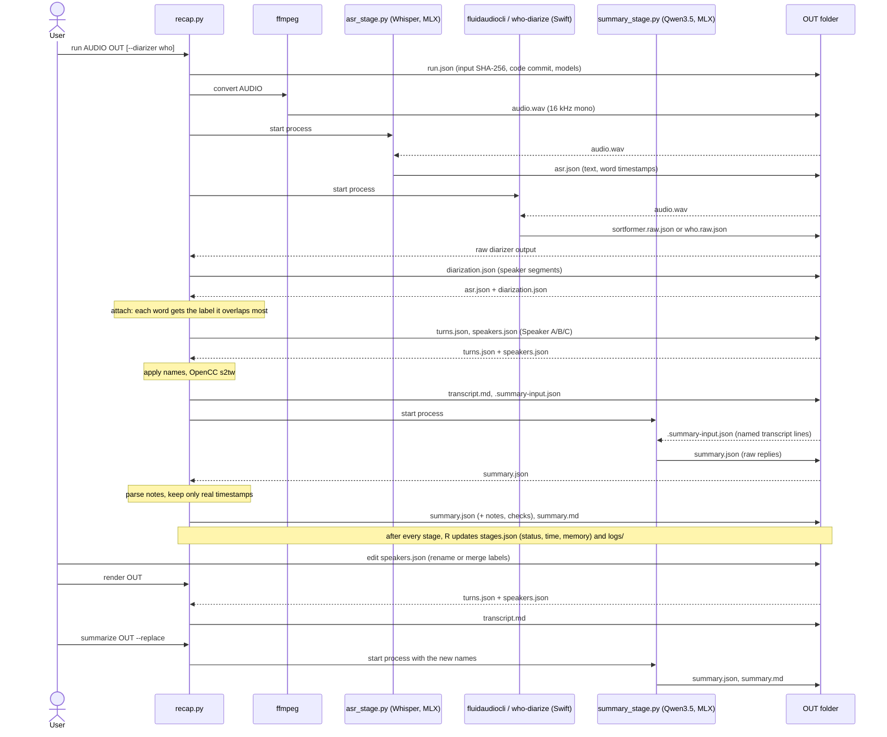

# whisper-sortformer pipeline

The first end-to-end pipeline for a saved recording ([#28](https://github.com/pomodorozhong/meeting-recap/issues/28)): audio → Whisper Large v3 (Mandarin by default, word timestamps) and Sortformer → speaker labels attached per word → an editable speaker mapping → a Traditional Chinese Markdown transcript → a local recap of topics, decisions, action items, proposals and open questions, each with transcript timestamps.

It assembles the baseline from [decision 1](../../../docs/decisions.md) without further model comparison. It is made for an online call with two or three speakers in Mandarin with English terms. Everything runs locally on an M2 Pro with 16 GB of memory.



`recap.py` drives every stage, and the stages pass data only through files in the output folder. Each model (Whisper, the diarizer, Qwen) runs in its own process, one at a time, so only one model is in memory at once. `--resume` continues from the first stage that `stages.json` doesn't record as completed. Editing `speakers.json` and running `render` or `summarize --replace` rebuilds the transcript or recap from saved files, without rerunning ASR or diarization.

## Setup (once, needs the network)

From the repository root:

```bash
cd experiments/pipelines/whisper-sortformer
swift build -c release --product fluidaudiocli
swift build -c release --product who-diarize   # only for --diarizer who
cd -
uv run --project experiments/pipelines/whisper-sortformer experiments/pipelines/whisper-sortformer/recap.py setup
```

- `swift build` takes about two and a half minutes. It builds FluidAudio's `fluidaudiocli` at the pinned revision into this folder's `.build/`.
- `setup` downloads the two pinned Hugging Face snapshots (Whisper about 3 GB, Qwen about 5.6 GB) to the Hugging Face cache. It also runs Sortformer once on generated silence, so FluidAudio downloads its models to `~/Library/Application Support/FluidAudio/Models`.
- `ffmpeg` and `ffprobe` must be on `PATH` (`brew install ffmpeg`).
- For `--diarizer who`, run `setup --who` as well. It downloads Who's int8 weights (44 MB) to `~/Library/Application Support/meeting-recap/who`, or to `$WHO_MODELS` if set.
- **Weight digests:** FluidAudio fetches Sortformer's weights from its model repo's `main` branch, not a fixed revision. So `setup` hashes every downloaded diarizer file and refuses weights whose SHA-256 differs from `pins.py`. If it refuses after a fresh download, the upstream weights changed and the baseline below no longer applies to them.

## Run (offline)

```bash
uv run --project experiments/pipelines/whisper-sortformer experiments/pipelines/whisper-sortformer/recap.py run recording.m4a ~/meeting-notes/2026-11-01-call
```

- **Input:** any file ffmpeg reads. Use `--language en` for an English recording; the default `zh` is for Mandarin, including calls with English terms. This selects the spoken language for ASR; the recap prompt still requests Traditional Chinese. A resumed run must use its original language.
- **Output folder:** must be new or empty, and outside this Git checkout. An existing run is never replaced.
- **Offline:** both Python model stages run with `HF_HUB_OFFLINE=1`, so they fail rather than download a different revision. Sortformer loads FluidAudio's cached models. Before any stage runs, `run` checks the chosen diarizer's weights against their pinned SHA-256 (about 0.2 s), and refuses on a mismatch.
- **Fast option:** cache both ASR revisions with `setup --asr all --who`; then add `--asr turbo-q4 --diarizer who` to `run`. You can also use Turbo with Sortformer. The run records the exact ASR revision and rejects a resume with a different model.
- **Long digital pauses:** `--split-digital-pauses` with full Whisper decodes speech spans separately when at least five seconds of samples are exactly zero. It keeps 250 ms of context at each cut and restores the source timestamps. This option targets digital edits and mutes; ordinary room noise does not trigger it.
- **Digital silence:** when every converted sample is exactly zero, the transcript is empty and the recap identifies the silent recording. Neither Whisper nor the recap model runs. Quiet nonzero audio takes the ordinary path.

Use `--keep-asr-segments` to give the recap a timestamp for each Whisper segment even when the speaker stays the same. On three synthetic calls this improved citation support on two and tied on one. Check the cited words: two lines can share a displayed second, and a valid timestamp does not guarantee a correct claim.

- **Order:** stages run one after another. Each model runs in its own process, so its memory is freed before the next model loads.
- **`--no-summary`:** stops after the transcript.
- **`--diarizer who`:** uses Desert Ant Labs Who (int8) instead of Sortformer. It labels speakers in seconds instead of minutes. It refuses to run when its weights are missing rather than downloading them. Each load sends the SDK's licence check (an install ID, versions and platform, no audio) to `events.desertant.com`; the Who experiment ([#25](https://github.com/pomodorozhong/meeting-recap/pull/25)) found inference still works when that server is unreachable. Its licence is source-available. Sortformer stays the default until #25's long-call scores are in. A resumed run must use the diarizer it started with.

| Stage | Writes | What it does |
| --- | --- | --- |
| `convert` | `audio.wav` | ffmpeg to 16 kHz mono 32-bit float, keeping the time origin |
| `asr` | `asr.json` | Whisper Large v3 through `mlx-whisper`: explicit `zh` or `en`, word timestamps, `condition_on_previous_text=False` |
| `diarize` | `sortformer.raw.json` or `who.raw.json`, `diarization.json` | FluidAudio Sortformer (`fluidaudiocli sortformer`) or Who (`who-diarize`), converted to segments |
| `attach` | `turns.json`, `speakers.json` | Each word gets the label it overlaps most (else the nearest within 1 s). Same-label words less than 1 s apart form one turn |
| `transcript` | `transcript.md` | Speaker names applied, OpenCC `s2tw` to Traditional characters, one `**[HH:MM:SS] Name:**` paragraph per turn |
| `summary` | `summary.json`, `summary.md` | Qwen3.5 9B through `mlx-lm`, described below |

`run.json` records the input's name and SHA-256, the code commit, the pinned models and the diarizer weights' SHA-256. It also records the environment: macOS, Mac model, chip, memory, and the Python, MLX, `mlx-whisper`, `mlx-lm`, Swift and ffmpeg versions. `stages.json` records each stage's status, wall time, peak memory and output digests, or its error. `logs/` holds each process's output and `/usr/bin/time -l` report.

### Names and merging speakers

`speakers.json` maps each diarization label to a name. Defaults are `Speaker A`, `B`, `C` in order of first appearance, and `Unknown speaker` for words outside every diarization segment. Edit the names, then rebuild the transcript without rerunning any model:

```json
{"labels": {"Speaker_0": "Speaker A", "Speaker_2": "Speaker B", "Speaker_3": "Speaker B"}}
```

```bash
uv run --project experiments/pipelines/whisper-sortformer experiments/pipelines/whisper-sortformer/recap.py render ~/meeting-notes/2026-11-01-call
```

Giving two labels one name merges them, as when Sortformer splits one voice across two labels. `render` refuses a mapping that leaves a label out. A later `run --resume` never overwrites an edited `speakers.json`.

The recap names speakers as they were when it ran. `render` says when the names have changed since. Run `summarize OUT --replace` to rewrite `summary.md` with the new names.

### Recap

The transcript goes to the model as `[HH:MM:SS] Name: text` lines, split into chunks of about 6,000 characters (about 15 minutes of speech), never mid-line.

**Prompts and decoding.** Each chunk gets one prompt: [`pipeline.extract_prompt`](pipeline.py). A recording with several chunks gets one more prompt that merges the chunk notes. Decoding is greedy with thinking disabled, up to 4,096 tokens per reply.

**What the model is told:**
- Write in Traditional Chinese and keep English terms.
- Keep decisions apart from proposals and open questions.
- Fill an owner or deadline only when the transcript states it.
- Cite the timestamps that support each point.

**Checks after the reply.** The pipeline keeps only cited timestamps that begin a transcript line. `summary.md` marks an item with no remaining support as "(no supporting timestamp)". `summary.json` keeps every raw reply, the parsed notes and the counts of dropped evidence.

**Limits.** The recap is a first draft. Nothing checks that a cited line actually says what the item claims. Read the cited lines before relying on a decision or an action item.

## Failures and reruns

- **A failed stage:** the run exits nonzero with `error: stage <name> failed: …` and the last log lines. `stages.json` records the failure, and every completed output stays. Fix the cause and rerun with `--resume`. It reruns only stages that aren't recorded as completed with unchanged output digests, and it refuses a different recording.
- **Sortformer:** `fluidaudiocli` exits 0 even when it fails, so the diarize stage treats a missing output file as a failure.
- **Partial files:** outputs are written beside their destination and renamed into place, so a crash leaves no half-written file under its final name.
- **Summary refusal:** `summarize` refuses to replace `summary.md` unless given `--replace`.

## Measurement

Each stage process runs under `/usr/bin/time -l`. `stages.json` records:
- **`wall_seconds`:** wall time.
- **`max_rss_bytes`:** maximum resident set size.
- **`peak_footprint_bytes`:** the peak memory footprint macOS reports.

Neither of the last two counts Metal buffers fully. For an MLX model they can show under 1 GB while the GPU holds about 5 GB of weights. The MLX stages therefore also record **`mlx_peak_bytes`**, MLX's own peak allocation; read memory for those stages from that field. The `total` entry is the wall time of that invocation only, so a resumed run counts just the stages it ran.

## Pins

Each pin is written down once:

- **Model revisions and weight digests:** [`pins.py`](pins.py) holds the Whisper and Qwen Hugging Face revisions and the SHA-256 of the Sortformer and Who weight folders. Whisper runs through `mlx-whisper` and the recap through `mlx-lm`. Licences: Qwen3.5 is Apache-2.0, and Who is under the Desert Ant Labs Source-Available License.
- **Swift packages:** [`Package.resolved`](Package.resolved) holds the FluidAudio and `desert-ant-core` revisions. `pins.py` reads them from there, and a test checks that `Package.swift` asks for the same ones. The `desert-ant-core` revision is tag `v4.2.1`, which names the Who weights `desert-ant-labs/who` `v0.3.4`, Core ML int8. Sortformer's model is `Sortformer_v2.1.mlmodelc`, as in [docs/runners.md](../../../docs/runners.md).
- **Python packages and interpreter:** [`uv.lock`](uv.lock) and [`.python-version`](.python-version). Script conversion uses `opencc-python-reimplemented`'s `s2tw`.

Python dependencies are in this folder's uv project. Rerun `uv lock` here after changing them.

## Tests

From the repository root, with generated audio and the model processes replaced by fakes:

```bash
uv run --project experiments/pipelines/whisper-sortformer python -m unittest discover -s tests/pipelines -t tests/pipelines
```

## Reproduce

The baseline below ran on this environment, as `run.json` now records it (the baseline runs predate that record; these are the same machine's versions on the same day):
- an M2 Pro (Mac14,9) with 16 GB of memory, on macOS 26.6.2;
- Python 3.12.13, MLX 0.32.4, `mlx-whisper` 0.4.2 and `mlx-lm` 0.32.2, from `uv.lock`;
- Swift 6.3.3 and ffmpeg 9.0.2.

To reproduce it, generate the call (see [its README](../../synthetic-call/README.md)), run the pipeline on it, and score the run against the call's known turns:

```bash
uv run --project experiments/synthetic-call experiments/synthetic-call/generate.py
uv run --project experiments/pipelines/whisper-sortformer experiments/pipelines/whisper-sortformer/recap.py run experiments/synthetic-call/out/script/call.wav ~/meeting-notes/synthetic-call
uv run --project experiments/synthetic-call experiments/synthetic-call/score_speakers.py --asr ~/meeting-notes/synthetic-call/asr.json --segments ~/meeting-notes/synthetic-call/diarization.json --turns ~/meeting-notes/synthetic-call/turns.json --audio experiments/synthetic-call/out/script/call.wav
```

Add `--diarizer who` to `run`, into a new folder, for the Who column. On the same hardware and versions, expect the speaker agreement figures below. On other hardware or versions, expect close but not identical results: Whisper's word times, Sortformer's turns and the recap's wording can all shift slightly. Times scale with the chip and with what else is running. Compare the call's `call_sha256` first, as its README says.

## Baseline on the synthetic call (2026-11-01)

The [synthetic call](../../synthetic-call/README.md) (seed 7, 5:29, three speakers, 73 turns) ran through every stage with `run`, on an M2 Pro with 16 GB of memory running macOS 26.6.2. Nothing else heavy was running.

### Time and memory

| Stage | Wall time | × audio length | Peak memory |
| --- | --- | --- | --- |
| convert | 0.2 s | — | — |
| asr | 47 s | 0.14× | 3.96 GB (MLX) |
| diarize | 136 s | 0.41× | 0.79 GB footprint, 1.06 GB RSS |
| attach + transcript | 0.1 s | — | — |
| summary (one chunk, about 2,000 prompt tokens) | 99 s | — | 6.71 GB (MLX) |
| **total** | **283 s** | **0.86×** | **6.71 GB**, one model at a time |

- **Matches earlier runs:** Sortformer's 0.41× matches its 2026-10-24 runs on 87 minutes of a real call.
- **Projection, not measured:** an hour-long call would take about 33 minutes before the summary (0.55×). The summary adds about one prompt per 15 minutes plus a merge prompt.

**With `--diarizer who`** (same call, same day):

| Stage | Sortformer | Who |
| --- | --- | --- |
| diarize | 136 s, 0.79 GB footprint | 2.1 s (0.4 s load, 0.7 s diarizing), 0.27 GB footprint |
| asr | 47 s | 47 s, identical text |
| summary | 99 s | 82 s |
| **total** | **283 s (0.86×)** | **132 s (0.40×)** |

With Who, Whisper and the summary model are the slow stages. An hour-long call would take about 9 minutes before the summary (projection, not measured). The summary's time varies by about 20 s between runs on the same transcript length.

### Quality

| Measure | Result | How |
| --- | --- | --- |
| Speaker agreement, diarization alone | 98.2% of characters | Each Whisper word's time is checked against the known turns, with the best label mapping |
| Speaker agreement, in the transcript | 95.1% of 1,317 aligned characters | Transcript characters are aligned to the script's text (OpenCC `t2s`, punctuation dropped), so text Whisper placed in the wrong turn counts as an error |
| Script characters recovered | 1,317 of 1,377 aligned | Same alignment; the rest are ASR errors |
| Labels | 4, for 3 speakers | The fourth holds 2 characters; renaming it in `speakers.json` merges it |
| Recap evidence | 6 topics, 7 decisions, 10 action items, 3 proposals, 2 open questions; every item kept a valid timestamp | Read by hand against the script, not scored |

With `--diarizer who`, measured the same way:
- **Speaker agreement:** 98.5% with diarization alone and 95.8% in the transcript, against Sortformer's 98.2% and 95.1%.
- **Labels:** exactly three, with no spare.
- **Turns:** 65 transcript turns, against Sortformer's 67 (73 in the script).
- **Recap:** 8 topics, 7 decisions, 8 action items, 3 proposals and 3 open questions, all with valid timestamps.

On this one generated call Who is at least as good end to end. That differs from #25, where Who kept slightly fewer turns apart on clip-level turn order. The two measures count different things, and one call can't settle it.

### Issues found, most important first

The point of this baseline is to see where the whole pipeline loses most before optimizing any part. Each issue needs its own measurement on a real recording before it is fixed.

1. **Words cross turn boundaries.** Whisper's word times drift at turn changes, so a reply's first character often stays with the previous speaker (「聽」 then 「得到」). This costs about 3 points of speaker agreement on top of diarization's own errors, and it is visible on almost every short reply. Candidate fixes: split turns at Whisper segment or punctuation boundaries that lie near a diarization change, or align words with a separate forced aligner.
2. **The recap mixes assignments into decisions.** Who does what appears both as decisions and as action items, two action items repeat one task, and one action item's owner is doubtful. Every item cites real lines, but whether those lines support the item is checked only by reading. Only the private-recording review can say whether this matters.
3. **Runtime is dominated by Sortformer** at 0.41×, three times Whisper's time. `--diarizer who` removes this cost (2 s instead of 136 s). Choosing it as the default waits for its long-call scores in #25 and the private-recording review.
4. **ASR errors and punctuation.** Homophones land in the transcript and the recap (「分頁」 as 「糞頁」, 「時間」 as 「實踐」). Whisper writes mostly half-width punctuation (34 of 38 marks), which reads oddly in Chinese. `opencc-python-reimplemented` converts 「只有」 to 「隻有」 under both `s2tw` and `s2twp`.
5. **A spare speaker label** appears for a few characters. Naming handles it; nothing to change yet.

## Known limits

- **Speakers:** the speaker count is not set. Sortformer handles at most four speakers; Who is built for at most four per five-minute piece.
- **Overlaps:** overlapping speech goes to one speaker per word.
- **ASR runtime:** Whisper runs through MLX, not the WhisperKit CLI used on 2026-10-24. It has the same model weights but no VAD chunking, and long silences can still produce stray text.
- **Scope:** no live capture, GUI, or search.
